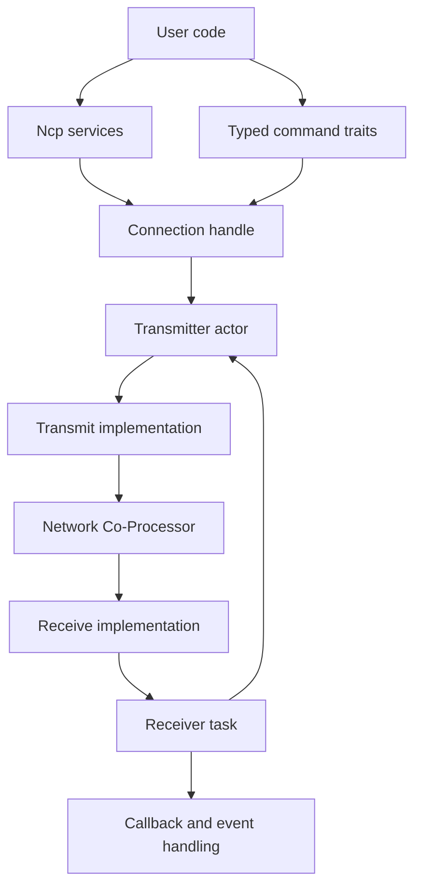
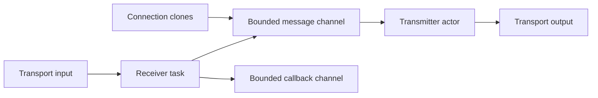
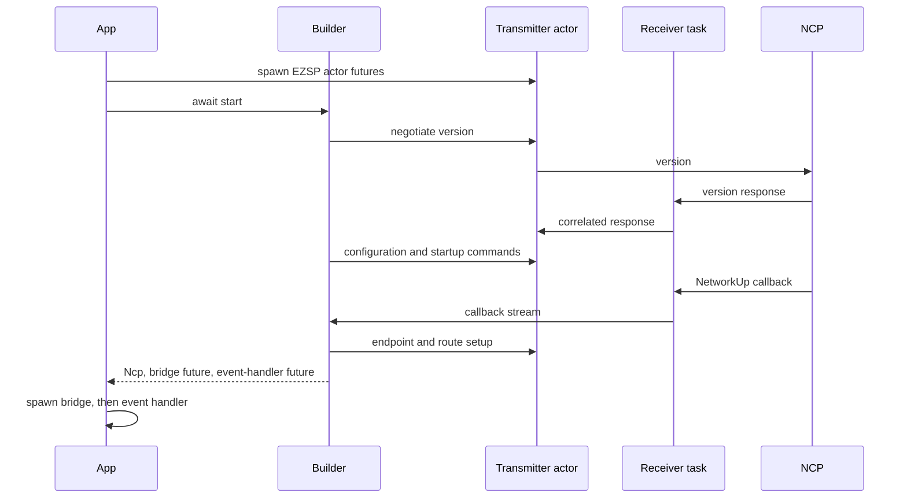
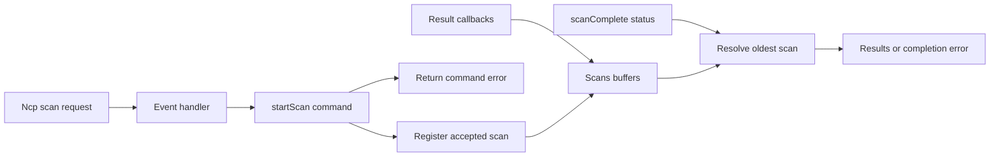
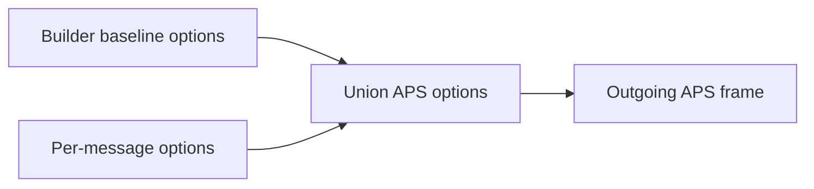
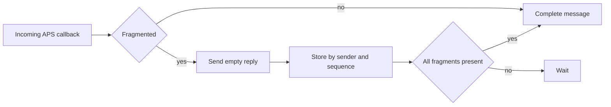
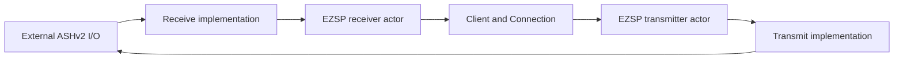
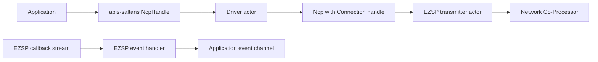
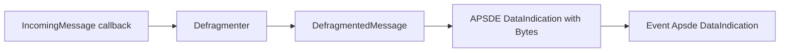
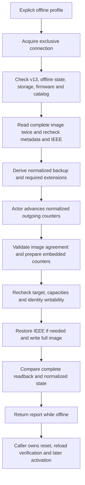

# Architecture

This document describes the actor-based architecture of the `ezsp` crate for
contributors.

## Layering

The crate has four cooperating layers:

1. Protocol model
   - EZSP legacy and extended headers
   - typed command, response, and callback parameters
   - Ember and EZSP data types
2. Transport actors
   - transport-specific `Transmit` and `Receive` traits
   - transmitter actor, receiver task, lifecycle handles, and callback routing
   - typed command traits built on `Communicate`
3. NCP services
   - startup builder and network lifecycle
   - endpoint metadata, scans, APS messaging, defragmentation, and event handling
4. Optional integrations
   - external transports, such as ASHv2, through `Transmit` and `Receive`
   - `apis-saltans` driver and event conversions

## Protocol model

`src/frame` owns the wire envelope and aggregate parameter types:

- `Header` selects `Legacy` or `Extended` framing.
- Legacy headers are three bytes and support one-byte frame IDs.
- Extended headers are five bytes and support two-byte frame IDs.
- `Frame<T>` combines a header with typed parameters.
- Outbound command parameter structs convert into the aggregate `Commands`
  enum used by the transmit actor.
- Inbound payloads parse into `Parameters::Response` or
  `Parameters::Callback` according to the frame ID.

Parameter parsing is ID-driven through
`Parameters::parse_from_le_stream(id, stream)`. Each command group has a public
trait under `src/commands` and matching wire parameter modules under
`src/frame/parameters`. A command-trait method constructs the relevant command
payload, calls `Communicate::communicate`, and converts the typed response.

`Ezsp` combines all command-group traits without adding methods or lifecycle
state.

## Transport actor system

### Transport boundary

The actor layer deliberately separates output from input:

- `Transmit::transmit` accepts one complete outbound EZSP frame and reports
  encoding or I/O errors.
- `Receive::receive` accepts the actor's current negotiated-version state and
  returns the next decoded inbound EZSP frame.
- `Client::run` is an associated constructor that creates a pre-negotiation
  `Client` and the internal transmitter and receiver futures that drive the
  EZSP actor layer.

This crate supplies no ASHv2 or other physical-transport implementation. The
boundary keeps EZSP transaction logic independent of the link layer and allows
an external transport crate to provide both halves.

### Caller-spawned tasks and channels

`Client::run(transmit, receive, channel_size)` creates the bounded channels and
returns the client together with `Futures`, exported from the crate root. The
caller spawns its fields as Tokio tasks:

1. `Futures::transmitter` owns the `Transmit` implementation and the actor inbox.
2. `Futures::receiver` owns the `Receive` implementation, sends responses back
   to the actor inbox, and sends asynchronous callbacks to the callback channel.

The message-channel capacity bounds both commands from connected handles and
responses forwarded by the receiver. The callback-channel capacity independently
bounds asynchronous callback buffering. Backpressure is therefore applied at
both boundaries.

### Lifecycle states

The channel endpoints form a `Client` handle before negotiation.
`Client::connect` sends an internal `Connect` message containing the
desired nonzero protocol version and a one-shot reply. Its actor futures must
already be running; `connect` does not spawn them.

The transmitter sends `version` using a legacy-compatible header. The generic
receiver actor initially calls `Receive::receive(None)`, records the protocol
version when it observes the decoded response, passes `Some(version)` to
subsequent receive calls, and forwards the response to the transmitter. A
matching version completes the one-shot request and produces:

- `Connection`, a cloneable sender-backed command handle; and
- the receiver of asynchronous `Callback` values.

The type transition prevents normal command methods from being called through
the standard API before negotiation succeeds. The caller owns the spawned task
handles and therefore also owns shutdown and failure handling.

### Command and response correlation

`Connection::communicate` converts a typed command into `Commands`, sends an
internal `Command` message, and awaits a dedicated one-shot channel. The
transmitter actor:

1. chooses legacy or extended framing from the negotiated version;
2. builds a header with the next wrapping sequence number and the command ID;
3. rejects the command if that sequence number is still occupied;
4. transmits the frame;
5. stores the response sender by sequence number; and
6. completes it when the receiver forwards the matching response frame.

The sequence map supports concurrent in-flight requests from cloned `Connection`
handles. It also prevents a wrapped sequence number from replacing an existing
request; collision returns `Error::TransactionQueueFull`.

The receiver routes payloads as follows:

- responses go to the transmitter actor;
- asynchronous callbacks go to the callback channel; and
- non-asynchronous callbacks go to the transmitter actor because some EZSP
  commands return callback-shaped payloads synchronously.

The actor only transports aggregate parameters. `Connection::communicate`
performs the final conversion into the response type declared by
`RespondsWith`; a mismatched payload becomes `Error::UnexpectedResponse`.

## High-level NCP services

### Builder ownership and startup

`Builder` owns a pre-negotiation `Client` and startup configuration:

- the callback-to-event-handler message capacity;
- desired EZSP protocol version;
- configuration and policy maps;
- optional concentrator parameters;
- radio transmit power; and
- baseline APS route-discovery and address options used for outgoing frames.

The builder exposes named methods for each supported baseline option. It moves
the resulting bit set into `Ncp` during construction; individual send calls
then supply any message-specific APS options.

`Builder::start(startup, endpoints, events)` requires a nonempty endpoint list
and an event type implementing `TranslatableEvent`. The current startup sequence
is:

1. require the caller to have spawned all transport actors;
2. negotiate the desired protocol version;
3. set concentrator, configuration, and policy values;
4. query the NCP identity and network state;
5. register every endpoint and construct `Ncp` while the network is down;
6. execute `Startup::Initialize` or `Startup::Resume`;
7. wait for a `NetworkUp` callback;
8. set runtime radio power and log current stack/security state;
9. issue the many-to-one route request;
10. return the callback-to-message bridge future; and
11. return the event-handler future.

Internally, `configure_stack` applies concentrator, configuration, policy, and
manufacturer settings. After endpoint registration, `start_network` handles the
selected startup mode and waits for `NetworkUp`. Lifecycle waits return
`Error::ChannelClosed` if the stream ends before the requested status arrives. `Builder::start` keeps these
stages in order and then performs runtime setup and constructs the futures.

`Builder::start` does not spawn tasks. The application must first start any
lower-level transport tasks, then spawn both actor futures returned by
`Client::run`, and only then await `start`. Once startup returns, it must
spawn the callback bridge before the event handler. This preserves dependency
order across bounded channels and avoids waiting on a lower layer that is not
being polled.

`Startup::Resume` calls `network_init` with the selected `InitBitmask`.
`Startup::Initialize` attempts to leave the current network, installs the
initial security state, and forms a network using `InitializationParameters`.
`NetworkCredentials` keeps the extended PAN ID, PAN ID, trust-center identity,
and network key together; the initialization value adds a preconfigured link
key, channel, join method, and initial-security bitmask.

### NCP implementation modules

The public `Ncp` type and its methods are implemented across private modules:

- `src/ncp.rs` owns construction, endpoint lookup, and termination.
- `src/ncp/messaging.rs` owns APS sends, payload limits, and outgoing fragmentation.
- `src/ncp/scanning.rs` owns scan requests and awaits their result channels.
- `src/ncp/scans.rs` aggregates the corresponding scan callbacks.

These modules share `Ncp` state without changing its public method paths.

### NCP state and endpoints

`Ncp` owns:

- a `Connection` communicator;
- the registered `Endpoint` descriptors;
- a sender to the event handler;
- baseline APS options configured by `Builder`.

`Ncp::connection()` borrows the command handle. Commands from borrowed and
cloned handles share the EZSP transmitter actor, response correlation, and
maintenance lock with the `Ncp`.

APS send methods require an explicit local source endpoint. Callers that want to
derive one from the registered descriptors can use `Ncp::source_endpoint`,
which scans endpoints in stored order and picks the first whose output clusters
contain the requested cluster. ZDP always resolves to endpoint zero. No match
returns `Error::NoMatchingSourceEndpoint`.

### Scan correlation

An active or energy scan sends a request and a one-shot result channel to the
event handler. The handler owns a separate clone of `Connection` for scan
commands. It issues `start_scan` and registers the result channel only if the
command succeeds, before consuming queued callbacks. Rejected commands return
the original error without leaving a pending registration.

`Scans` buffers results for the oldest accepted scan. `scanComplete` resolves
that scan with its buffered results or the callback's original error status,
and clears the buffers in either case. Unsolicited results are ignored.
Requests canceled before command dispatch are skipped. Once accepted, a scan
keeps its queue entry even if its caller cancels, so its eventual completion
cannot be attributed to another request.

The public `Message::NetworkScan` and `Message::ChannelScan` registration-only
variants remain available for callers issuing their own commands. Their legacy
result channels cannot carry errors, so a failed completion closes the channel.
`StartNetworkScan` and `StartChannelScan` provide the managed request path and
return `Result` values. Exhaustive matches on `Message` must handle these new
variants.

### APS sends and confirmation events

Callers supply an explicit source endpoint and the application APS `sequence`
used by unicast, multicast, and broadcast helpers. Each helper translates that
sequence into the EZSP message tag used for `messageSent` correlation. EZSP
separately assigns the APS sequence stored in the transmitted APS frame. The
EZSP command response indicates acceptance and, where applicable, supplies that
internal APS sequence. A later `messageSent` callback is normally forwarded
through the application event channel with the application sequence recovered
from its message tag.

Each helper accepts per-message `ember::aps::Options`. Frame construction
unions them with the baseline options inherited from `Builder`, so a caller can
add encryption or retry behavior without removing routing or address behavior
selected at startup.

Unicast payloads larger than `maximumPayloadLength` are split into APS
fragments. The first stack-assigned APS sequence is reused by later fragments,
and every non-final fragment registers a one-shot response channel before it is
sent. Its `messageSent` callback resolves that channel, and only a successful
response permits the next fragment to be sent. The final fragment does not
register a private channel, so its callback follows the normal application
event path. Fragmentation also enables `Options::RETRY` on every fragment.
Multicast and broadcast reject oversized payloads.

### Callback and event handling

The callback bridge converts received `Callback` values into internal NCP
messages. `EventHandler<T, E>` has four responsibilities:

- aggregate scan callbacks;
- route `messageSent` callbacks either to a registered fragment response or the
  application event channel;
- reassemble incoming APS fragments; and
- convert callbacks and complete incoming messages into `E`.

`TranslatableEvent` is a marker trait with a blanket implementation for types
implementing both `TryFrom<Callback>` and `TryFrom<DefragmentedMessage>`. The
event handler logs conversion failures and stops when it receives `Terminate`
or its inbox closes.

### APS defragmentation

`Defragmenter<T>` owns another clone of the connected communicator. Incoming
fragmented messages are keyed by sender and APS sequence. Each fragment is
acknowledged through an empty `sendReply` before it is stored. The configured
window bounds accepted fragment indexes, the receive-buffer limit bounds the
assembled payload, and `tick` removes expired packets.

## External ASHv2 integration

ASHv2 is an external adapter at the transport boundary; this crate has no
`ashv2` dependency, feature, re-export, UART module, or ASHv2-specific builder
constructor.

The outbound adapter implements `Transmit`. It consumes `Frame<Commands>`,
serializes its `Header` and command payload in little-endian order, and submits
the bytes as one ASHv2 DATA payload. The adapter maps encoding, capacity, and
I/O failures into `crate::Error`.

The inbound adapter implements `Receive`. On each call it obtains a complete
ASHv2 DATA payload and uses the supplied negotiated version to parse `Legacy`
headers before negotiation or `Extended` headers after a sufficiently new
version, then calls
`Parameters::parse_from_le_stream` with the decoded frame ID and remaining
bytes. It should also reject truncated or overflowed response headers and
handle `invalidCommand` responses consistently with the public error model.
Because `Receive::receive` returns `Option<Frame<Parameters>>`, malformed-frame
logging, skipping, and stream-termination policy belong to the adapter.

The generic actor owns the negotiated-version state. It passes `None` to
`Receive::receive` until it recognizes the decoded `version` response, then
passes `Some(version)` on subsequent calls. External ASHv2 tasks must be running
before the two futures returned by `Client::run`; both EZSP futures must be
running before `Builder::start` initiates negotiation.

EZSP and ASHv2 have no frame fragmentation boundary: each complete EZSP frame
must fit in one ASHv2 DATA payload. The external adapter defines how an
oversized encoded frame is reported as `crate::Error`.

## `apis-saltans` integration

The `apis-saltans` feature is implemented under `src/apis_saltans` and adds
traits/conversions without introducing another transport or NCP wrapper.

`Ncp` implements `apis_saltans_hw::Driver`. Driver operations map as follows:

- `get_endpoints` converts the stored `Endpoint` list to `SimpleDescriptor`,
  logging and filtering values with unknown profiles;
- `get_pan_id` reads the PAN ID from EZSP `getNetworkParameters`;
- `get_ieee_address` delegates to `getEui64`;
- active and energy scans convert validated `ChannelMask` and `ScanDuration`
  values to EZSP primitives, then reuse `Ncp` scan registration and callback
  aggregation;
- `allow_joins` converts the duration to whole seconds, clamps it to `u8::MAX`,
  issues `permitJoining`, and returns the effective duration;
- `route_request` issues a high-RAM many-to-one route request;
- short/IEEE address translation uses the validated `Device` short-ID type and
  EZSP lookup commands; and
- APSDE transmission maps supported request destinations to explicit-source
  `Ncp` unicast, broadcast, or multicast paths and propagates immediate
  acceptance failures.

`Builder::start` returns `Ncp` inside a `BuildResult`, rather than an
`NcpHandle`. Calling `Driver::into_actor(channel_capacity)` with a
`NonZeroUsize` creates the separate `apis-saltans` driver actor and returns its
`NcpHandle` plus a future. The application must spawn that future.

The driver actor serializes hardware API calls. The EZSP transmitter actor below
it serializes wire transmission and correlates sequence-numbered responses. APS
completion is a third asynchronous boundary: the event handler translates the
final `messageSent` callback into an APSDE `DataConfirm` event.

### Endpoint conversion

`conversion/endpoint.rs` converts `SimpleDescriptor` into the crate's raw
`Endpoint` representation for `Builder::start`. It copies the endpoint ID,
profile ID, device ID, application flags, and both cluster lists.

The reverse `TryFrom<Endpoint>` validates the raw profile.
`Driver::get_endpoints` clones every stored endpoint, attempts this conversion,
logs failures, and returns only valid descriptors. Values originating from a
`SimpleDescriptor` are expected to round trip.

### Destination mapping and send completion

The driver reads the destination, profile, cluster, explicit source endpoint,
ASDU, options, alias, and radius from each APSDE `DataRequest`. The separate
coordinator counter becomes the EZSP message tag. EZSP manages the APS sequence
placed in the transmitted frame independently. `TxOptions` map acknowledged
transmission to `ember::aps::Options::RETRY` and APS security to
`ember::aps::Options::ENCRYPTION`. `FRAGMENTATION_PERMITTED` authorizes
host-side unicast fragmentation. `USE_NWK_KEY` and `INCLUDE_EXTENDED_NONCE` are
rejected because EZSP cannot preserve them. Supported destinations map as
follows:

| APSDE destination | EZSP path | Destination endpoint | Routing values |
| --- | --- | --- | --- |
| Network | Explicit-source unicast | Requested endpoint | Direct short ID; radius must be zero |
| Extended | Address lookup, then explicit-source unicast | Requested endpoint | Resolved short ID; radius must be zero |
| Broadcast | Explicit-source broadcast | Requested endpoint | Requested radius |
| Group | Explicit-source multicast | Profile broadcast endpoint | Requested radius as hops; zero nonmember radius |

The request source endpoint is preserved and the mapped frame options are
combined with the NCP's baseline options. Bound destinations, aliases,
non-default group broadcast selectors, and nonzero unicast radii are rejected
because the corresponding EZSP send paths cannot preserve those semantics.
Final stack statuses are reported asynchronously as APSDE `DataConfirm` values,
using the coordinator counter recovered from the EZSP message tag.

### Callback and incoming-message conversion

`TryFrom<Callback> for apis_saltans_hw::Event` recognizes four callback
families:

- an acknowledged direct-unicast `MessageSent` becomes an APSDE `DataConfirm`;
- `ChildJoin` becomes `DeviceJoined` or `DeviceLeft` after validating its short
  address;
- successful `StackStatus` becomes `NetworkUp`, `NetworkDown`, `NetworkOpened`,
  or `NetworkClosed`; and
- `TrustCenterJoin` becomes join, secured/unsecured rejoin, or leave events.

Other callbacks, raw stack-status errors, unsupported stack statuses, and
invalid membership addresses fail conversion. Scan callbacks and non-final
fragment `messageSent` callbacks are consumed earlier by `EventHandler` for
request correlation.

Incoming APS messages follow a separate conversion path after defragmentation:

APSDE conversion maps unicast and broadcast message types to the coordinator
network address plus the received endpoint, and multicast types to group IDs.
It preserves the sender short address and endpoint, profile, cluster, payload,
and link quality. The event wrapper also maps the incoming APS frame's
`ZDO_RESPONSE_REQUIRED` option to `ApsdeEvent::DataIndication`'s
`zdo_response_required` field. EZSP exposes neither a reception timestamp nor a
key-pair handle, so those implementation-defined types are `()`. RSSI, binding
index, and source-route overhead have no fields in the new APSDE indication
model.

`TryFrom<DefragmentedMessage> for apis_saltans_hw::Event` wraps the completed
indication in `Event::Apsde(ApsdeEvent::DataIndication)`, so the hardware event
type satisfies both conversion bounds required by `TranslatableEvent`.

### Error conversion

The driver transmission entry point validates shared options and aliases before
dispatching by destination. Private helpers handle address resolution and each
send kind; direct and extended unicast destinations share the same send helper.
Unicast radius validation precedes address lookup. Lookup failures remain backend
errors, while send failures use the typed error conversion described below.

`crate::Error` converts into `apis_saltans_hw::Error::Network` for recognized networking
failures and `Error::Backend` otherwise. Both retain the original error as their source.
Unsuccessful final `messageSent` statuses become `ConfirmStatus::Failure`, carrying
a portable failure or an unclassified byte in `NetworkError::BackendStatus`. Incoming APS parsing uses the internal
`ParseApsFrameError` for invalid message types, addresses, endpoints, and group
IDs.

## Error boundaries

`Error` unifies transport I/O, channel closure, decoding, status values,
protocol negotiation, invalid responses, endpoint selection, and actor queue
collisions. Transport implementations return it from `Transmit`; higher layers
preserve it through command traits, startup, and NCP workflows.

The most actor-specific failures are:

- `ProtocolVersionMismatch` when `version` does not accept the requested value;
- `TransactionQueueFull` when sequence-number wraparound finds the next number
  still occupied;
- `SendError` or `RecvError` when actor/one-shot channels close; and
- `UnexpectedResponse` when a correlated aggregate response cannot convert to
  the command's declared response type.

## Portable networking error mapping

`TryFrom<ember::Status> for NetworkError` maps known Ember statuses into common networking
failures and returns `Err(())` for statuses without a portable classification.
Both command error conversion and `messageSent` confirmation conversion use this mapping.
Command errors retain their concrete source. Confirmations carry portable failure semantics
when recognized, or the original byte in `NetworkError::BackendStatus` otherwise. Other status
namespaces keep their existing opaque representation.

## Backup firmware feasibility

The host implementation has a successful offline token-image backend and stateful
simulated end-to-end coverage. No NCP was available for hardware qualification, and
no production firmware profile is bundled. `apis-saltans` remains unchanged. The
optional traits are registered explicitly; without `OfflineTokenProfile` the existing
read-only qualification checks still reject complete capture and restore. A firmware
version string alone never enables writes.

### Reference evidence and scope

The local zsmartsystems Java checkout provides these reference paths:

- `ZigBeeDongleEzsp.setIeeeAddress` skips a matching operational address;
  `EmberNcp.setMfgCustomEui64` calls `setMfgToken` with eight protocol-order bytes.
- `ZigBeeDongleEzsp.setNetworkState(UNINITIALISED)` invokes token factory reset,
  ignores its result for old firmware compatibility, and leaves the network.
- `EmberNetworkInitialisation.setSecurityState` sets keys and the network-key sequence,
  then writes outgoing NWK/APS counters before `formNetwork` starts the network.

The Rust backend reuses the checked custom-EUI64 helper and preserves the keys,
sequence, and counter ordering. It restores complete persistent records instead of
reconstructing a network through initial-security/form-network commands. Factory
reset, leave, network initialization, formation, reboot, and resume are never implicit.
Incoming replay state and opaque child/policy metadata are preserved byte for byte.
The Java credential recovery flow does not establish that these records are available
in every stock firmware build.

Primary firmware evidence underlying the limits:

- [Gecko SDK 4.4 token serialization](https://github.com/SiliconLabs/gecko_sdk/blob/gsdk_4.4/protocol/zigbee/app/util/ezsp/ezsp-frame-utilities.c#L599)
  writes a 32-bit size and exactly that many bytes. The Rust codec bounds payloads
  at 64 bytes and clears unused backing storage.
- [Silicon Labs token-backup limitations](https://docs.silabs.com/zigbee/9.1.2/gp-combo-gateway-backup-restore/07-limitations)
  include non-atomic collection, missing incoming counters/RAM neighbor state, and
  reset requirements for operational table reload. Generic token copying cannot
  satisfy the complete-backup contract when required state is absent.
- [Operational EUI64 restoration](https://docs.silabs.com/zigbee/9.1.2/gp-combo-gateway-backup-restore/04-saving-and-restoring-the-operational-eui64)
  documents a restored-EUI64 token with boot-time support. The implemented Java-style
  custom manufacturing token is a distinct mechanism, whose behavior must be qualified.
- [Newer token-interface layouts](https://docs.silabs.com/zigbee/8.2.2/sisdk-ezsp-reference-guide/16-token-interface-frames)
  use `sl_status_t`; the current token response codec models an 8-bit Ember status.
  Complete operations and metadata inspection therefore require negotiated EZSP v13.

### Explicit offline firmware contract

`backup/profile.rs` defines a public `OfflineTokenProfile`: a stable profile ID,
exact firmware version string, ordered full token catalog, and locations of every
normalized field. Each `TokenField` specifies key, element index, and byte offset.
Field bounds and overlaps are validated before I/O; only exact aliases of outgoing
APS counters are permitted. A profile must change ID whenever layout, coverage, or
semantics change. The ID and metadata identify a contract; they do not authenticate
firmware or prove its completeness.

Selecting a profile asserts ALL of the following, which simulation cannot prove:

1. The entire catalog is portable, writable core state, not device calibration or
   local key handles. All required keys/seeds, policies, child metadata, device
   records, and incoming replay state are persistent and included. There is no
   required RAM-only state. Every required device slot and outgoing counter is
   mapped. Opaque bytes do not hide additional counters requiring advancement.
2. `NoNetwork` is quiescent while the original saved network still exists. No scan,
   pending transition, other transport client, or autonomous work changes state.
   Two equal reads are only a detection check, not proof of atomicity. Network leave
   or factory reset cannot be used as an assumed lossless source-freeze mechanism.
3. Token writes synchronously update durable storage, accept full elements, and
   readback reflects that storage. Runtime configuration matches the profile;
   key and child capacities are additionally checked before restoration.
4. Before later activation, firmware reloads restored tokens into RAM without
   discarding or lowering keys, counters, identity, child records, or replay state.
   If reset/reconnection is required, the application performs it offline, reapplies
   matching runtime configuration, and verifies reload before explicit startup.
5. Classic key storage and supported global/hashed Trust Center modes are used.
   PSA handles, distributed/install-code-derived initialization, pending alternate
   network-key transitions, and firmware requiring a different identity mechanism
   are unsupported by this backend.

Stock firmware that omits required replay state cannot meet this contract merely by
supplying a token layout. It needs firmware support or a different complete-state
backend. There is deliberately no automatic profile selection or synthetic production
layout. The test profile describes an invented persistent image, not real NVM3 keys.

### Capture, planning, and restoration

`backup/offline.rs` executes the configured profile through typed EZSP commands:

Capture rejects active targets before reading keys, verifies the exact ordered catalog,
reads every element including unused slots twice, checks identity stability and repeats
metadata checks. Normalized network parameters, security keys, device addresses, child
markers, and replay counters are derived from these same bytes, avoiding separate
credential exports with unrelated counter observations.

`backup/plan.rs` checks source, schema, and required extensions before target I/O.
`RestorePlan::prepare` accepts original snapshots. The actor path consumes normalized
counters already advanced by upstream `prepare_restore`; it never advances them twice.
The planner separately advances the security extension's global APS counter. Opaque
image counters remain original until the configured backend applies the layout.

Restore reconstructs an original normalized snapshot from the raw image and compares
its prepared form with the supplied plan, including all extensions. Mismatches fail
before target I/O. The backend then patches outgoing NWK and APS/link counters in
its image copy with checked arithmetic. Exactly shared APS fields are deduplicated;
incoming counters, key bytes, sequence numbers, empty slots, and opaque bytes remain
unchanged. Unknown extensions and alternate-key transitions are rejected.

Read-only validation checks offline state, storage, exact firmware/catalog, key/child
capacities, and operational/custom IEEE writability. Apply repeats this validation
within its own exclusive session, including for direct trait callers. IEEE restoration
skips an already matching address. A non-erased incompatible custom token is rejected.
A newly written identity requiring reset returns `PossiblyModified` before network
record writes; callers must explicitly reset/reconnect and retry. There is no hidden
factory reset to make a custom token writable.

After writing every record, apply compares exact full readback, repeats metadata and
offline checks, verifies the operational IEEE, reprojects normalized state, and only
then creates `RestoreReport::from_verified_backup`. Pre-write failures are `Unchanged`;
failures after a write attempt, including a lost acknowledgement, are `PossiblyModified`
with the backend source preserved. No rollback is attempted. No success report claims
reset persistence, RAM reload, or successful encrypted traffic on real hardware.

`Connection::maintenance` acquires a shared connection-wide write permit; ordinary
transactions hold read permits. This blocks all clones, including callback-generated
commands, while transport responses continue to flow. The command message and pending
response retain their permit even if a caller is canceled. Existing commands therefore
finish before maintenance begins; an unresponsive command requires transport recovery,
not bypassing the gate. Applications must drain callbacks and prevent autonomous NCP
activity independently. A separate transport client is outside this gate.

The upstream driver actor completes accepted operations even when only the response
future is dropped. Aborting that actor, transport loss, or canceling a direct restore
can leave partial storage. The application must keep the target offline and validate
or fully repeat restoration before activation; there is no persisted host recovery
journal. Dropping a maintenance session releases it after any in-flight command reply,
not after arbitrary future firmware work.

### Required extensions

`backup/security.rs` defines `org.silabs.emberznet/security`, version 1:

| Offset | Length | Content |
| --- | --- | --- |
| 0 | 2 | Little-endian initial security flags |
| 2 | 16 | Trust Center key or hashed-key seed |
| 18 | 4 | Little-endian global outgoing APS counter |

The payload is exactly 22 bytes. Unknown identifiers, flags, versions, and trailing
bytes are rejected. Network/preconfigured keys and global or hashed Trust Center mode
are required. This extension alone does not contain a complete firmware snapshot.

`backup/image.rs` adds required `org.silabs.emberznet/tokens`, version 1:

| Order | Encoding | Content |
| --- | --- | --- |
| 1 | u8 then UTF-8 bytes | Profile ID length and ID, 1 through 64 bytes |
| 2 | u16 little-endian | Number of token elements, at most 4096 |
| 3, repeated | u32 little-endian | NVM3 key |
| | u32 little-endian | Array element index |
| | u8 then bytes | Element length, 1 through 64, and secret-bearing data |

Payloads over 256 KiB, unsupported versions, truncation, and trailing bytes are rejected.
Profile validation additionally requires exact catalog order, element counts, lengths,
and ID; missing, reordered, duplicate, and extra records fail. The complete extension
is required for this backend; security-only snapshots keep their existing read-only
planning support but cannot be applied. Debug output redacts token/key bytes. Explicit
byte access and transport logging remain secret-bearing; memory zeroization and
backup-file encryption/authentication are outside this crate.

### Verification and remaining acceptance

The stateful simulator models durable token records and derives actual wire responses
from them. Tests use real `Connection` messages and the released `apis-saltans` actor
for successful capture and restoration. They cover full image preservation, individual
and shared outgoing counters, incoming replay counters, IEEE restoration and deferred
reset, corrupt readback, lost write acknowledgement, live/changing sources, capacity
and catalog mismatch, normalized/image disagreement, malformed/truncated images,
layout bounds/overlaps, and exhaustion before I/O. Permit tests cover cloned handles
and canceled in-flight commands. Existing unconfigured-profile tests remain in place.

Real acceptance still requires the exact firmware/token layout and an actual source
and replacement NCP. Verify lossless offline preparation, all replay/child/policy state,
snapshot quiescence, durable writes, IEEE persistence, and offline reset/reconnect/RAM
reload with suitable runtime configuration. Then confirm encrypted communication and
counter monotonicity after explicit activation, plus recovery from failed writes and
power loss. These are unresolved firmware contracts and hardware evidence, not claims
that the synthetic profile proves stock firmware complete.
