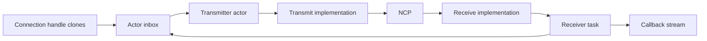

# ezsp

Actor-based host support for the EmberZNet Serial Protocol (EZSP).

EZSP is the command protocol used by a host application processor to control
the EmberZNet PRO stack running on a Silicon Labs Network Co-Processor (NCP).
This crate models typed command, response, and callback payloads; legacy and
extended frame headers; transport-independent actors; high-level Zigbee
workflows; and a transport API that external link implementations, including
ASHv2, can use.

## Documentation basis

The protocol model follows these Silicon Labs references:

- `UG100: EZSP Reference Guide`, Rev. 5.1, for EmberZNet PRO 7.4.2.
- `UG101: UART-EZSP Gateway Protocol Reference`, Rev. 1.3, for ASHv2 over UART.
- <https://docs.silabs.com/zigbee/latest/sisdk-ezsp-reference-guide/>, the
  current Simplicity SDK EZSP reference.
- <https://docs.silabs.com/zigbee/6.6/em35x/>, the older EmberZNet API
  reference used by several Ember type descriptions.

The implementation retains the legacy EZSP and Ember names where they are part
of the crate API.

## Features

- `apis-saltans` implements `apis_saltans_hw::Driver` for `Ncp` and supplies
  callback/event and data-model conversions.
- `semver` enables `semver` support in EZSP version APIs.

This crate does not depend on, re-export, or provide an implementation of
ASHv2. An ASHv2 crate can integrate by implementing the public `Transmit` and
`Receive` traits.

## Actor model

The transport API separates outbound and inbound I/O:

- `Transmit` sends a complete `Frame<Commands>`.
- `Receive` yields decoded `Frame<Parameters>` values and accepts the negotiated
  EZSP version used by version-sensitive decoders.
- `Client::run` is an associated constructor that wraps those transport halves
  and returns a newly wired `Client` plus `Futures` for the caller to spawn.
- `Futures` is exported from the crate root and contains the transmitter and
  receiver actor futures.
- The returned `Client` represents the actor channels before protocol
  negotiation.
- `Client::connect` sends the initial `version` command and returns a
  cloneable `Connection` handle together with the asynchronous callback stream.
- `Connection` implements `Communicate`; all EZSP command-group traits are
  blanket-implemented for communicators.

Every `Connection::communicate` call sends an actor message and waits on its own
one-shot response. The transmitter actor assigns an EZSP sequence number,
serializes outbound access, and correlates inbound responses by that number.
Cloned handles can therefore be used by independent tasks without placing the
transport behind a mutex. Asynchronous callbacks bypass response correlation
and are delivered through a separate bounded channel.



Transport implementations supply independent `Transmit` and `Receive` halves.
Pass both halves to `Client::run` and spawn both returned actor futures before
version negotiation. The transport implementation remains responsible for
running any lower-level I/O tasks that feed those halves.

## Typed protocol API

EZSP command methods are grouped into traits such as `Configuration`,
`Messaging`, `Networking`, `Security`, and `Utilities`. Each method creates a
typed command parameter, calls `Communicate::communicate`, and converts the
correlated response into its public return type. `Ezsp` is a convenience trait
combining the complete command surface.

The lower-level frame model remains public for transport implementations and
protocol tooling:

- `Frame`, `Header`, `Legacy`, and `Extended` model the EZSP envelope.
- `Commands` is the outbound aggregate consumed by `Transmit` implementations.
- `Parameters`, `Response`, and `Callback` classify decoded inbound payloads.
- `Parsable` performs frame-ID-directed parameter decoding, while the public
  `Decode`, `Status`, and `Error` types let adapters report compatible failures.
- Protocol data types are exposed through `ember`, `ezsp`, and the typed
  parameter modules.

EZSP fields wider than one byte are encoded little-endian. Protocol versions
before 8 use the three-byte legacy header; versions 8 and newer use the
five-byte extended header. The generic receiver actor records a successful
`version` response and passes the negotiated version to subsequent transport
receive calls.

## High-level NCP startup

`Builder` owns a pre-negotiation `Client` and the complete startup
configuration. The associated function `Client::run` creates that client and
returns it together with the `Futures` that drive it. After the caller spawns
those futures, `start`:

1. validates that at least one application endpoint was supplied;
2. negotiates the requested EZSP version through the running transport actors;
3. applies concentrator, configuration, and policy settings;
4. resumes the persisted network or forms an explicitly configured network;
5. waits for `NetworkUp`, applies runtime radio power, and sends a many-to-one
   route request;
6. registers the supplied endpoints;
7. creates the callback bridge and event-handler futures used for translation,
   scan aggregation, APS defragmentation, and message-confirmation correlation;
8. returns those futures with `Ncp` in a `BuildResult`.

Startup returns an error if the callback stream closes before the required
network-up or network-down status arrives.

`Builder::start` does not spawn either returned future. Spawn `bridge` before
`event_handler`, and keep both tasks running while using the `Ncp`.

The event channel passed to `Builder::start` determines the application event
type. That type must implement `TranslatableEvent`, which is automatically
implemented for types that can be constructed from both `Callback` and
`DefragmentedMessage`.

Builder methods configure callback and actor channel capacities, the desired
protocol version, EZSP policies and configuration values, concentrator
parameters, radio transmit power, and baseline APS options. The named APS
option methods enable route discovery, forced route discovery, source or
destination EUI-64 inclusion, and address discovery for every outgoing frame.
Per-message options supplied to the send methods are combined with this
baseline.

`Startup::Resume` restores state persisted by the NCP through `networkInit` and
is the normal choice for restarts:

```rust
use ezsp::Startup;
use ezsp::ezsp::network::InitBitmask;

let startup = Startup::Resume(InitBitmask::NO_OPTIONS);
```

`Startup::Initialize` intentionally replaces the current network. It attempts
to leave the current network, installs the initial security state, and forms a
network from `InitializationParameters`. `NetworkCredentials` groups the
extended PAN ID, PAN ID, trust-center EUI-64, and network key; initialization
parameters add the preconfigured trust-center link key, channel, join method,
and initial security bitmask.

```rust
use ezsp::{InitializationParameters, NetworkCredentials, Startup};

let credentials = NetworkCredentials::new(
    extended_pan_id,
    pan_id,
    trust_center_eui64,
    network_key,
);
let parameters = InitializationParameters::new(
    credentials,
    link_key,
    radio_channel,
    join_method,
    security_bitmask,
);
let startup = Startup::Initialize(parameters);
```

`NetworkCredentials` contains secret key material. Its `Debug` output redacts
keys; protect explicitly accessed, persisted, or copied credentials appropriately. Random
credentials can be sampled with `rand`, but the distribution accepts any RNG;
production callers are responsible for selecting a cryptographically secure
one.

## High-level NCP operations

`Ncp` owns the connected communicator and endpoint metadata. It adds
workflows that span commands and asynchronous callbacks:

- active-network and energy scans, completed by `scanComplete`;
- unicast, multicast, and broadcast APS sends;
- application APS sequence correlation with `messageSent` callbacks through
  EZSP message tags;
- incoming APS fragment reassembly;
- source-endpoint lookup from registered output clusters; and
- event-handler shutdown through `Ncp::terminate`.

`Ncp::scan_networks` and `Ncp::scan_channels` return both immediate command
rejections and failures reported by `scanComplete` as errors. Failed scans do
not leave results or registrations for the next request. Canceling an accepted
scan's future does not stop the NCP scan: the event handler consumes its eventual
completion before resolving later scans. Both the callback bridge and event
handler must be running while awaiting scan results.

Awaiting `Ncp::unicast`, `Ncp::multicast`, or `Ncp::broadcast` performs the EZSP
send transaction. Each method requires the local source endpoint explicitly.
The caller also supplies an application APS `sequence`, which the helper
translates into the EZSP message tag used to correlate the later asynchronous
`messageSent` callback. EZSP manages the APS sequence in its frame independently.
Completed sends are reported through the application event channel using the
application-provided sequence.

`Ncp::source_endpoint` returns the first registered endpoint in the supplied
endpoint-list order whose output clusters contain the requested cluster. It
does not sort endpoints by number. ZDP uses endpoint zero.

Each send method takes an `aps_options: ember::aps::Options` argument and the
application APS `sequence: u8`. Unicast also takes a
`fragmentation_permitted: bool`. The per-message options are combined with the
options configured on `Builder`; pass `Options::NONE` when a message needs no
additional flags. For example, a caller can request APS encryption and retry
for one unicast without changing the baseline used by later sends:

```rust
use ezsp::ember::aps::Options;

let options = Options::ENCRYPTION.union(Options::RETRY);
ncp.unicast(
    source_endpoint,
    short_id,
    profile_id,
    cluster_id,
    destination_endpoint,
    payload,
    options,
    sequence,
    true,
)
.await?;
```

Oversized unicasts are split into APS fragments. Multicast and broadcast
payloads must fit the maximum payload reported by the NCP. Fragmented unicasts
enable APS retry in addition to the combined baseline and per-message options.
The event handler privately acknowledges every non-final fragment back to the
sender, so each callback drives transmission of the next fragment. The final
fragment has no private response channel and produces the normal application
ACK or NAK event.

## APS defragmentation

`Defragmenter<T>` reassembles fragmented incoming APS unicasts for any
`T: Messaging`. `handle` acknowledges each fragment with the required empty
`sendReply` and returns a `DefragmentedMessage` after the complete payload is
available. The high-level event handler owns a defragmenter using its clone of
the `Connection` actor handle and emits incoming-message events only for complete
payloads.

Reassembly keys messages by sender and APS sequence, enforces the fragment
window and receive-buffer limits, and expires incomplete messages. Compile-time
environment variables can override the defaults:

- `EZSP_DEFRAGMENTATION_MAX_INCOMING_PACKETS`
- `EZSP_DEFRAGMENTATION_DEFAULT_WINDOW_SIZE`
- `EZSP_DEFRAGMENTATION_RECEIVE_BUFFER_LENGTH`
- `EZSP_DEFRAGMENTATION_REASSEMBLY_TIMEOUT_MILLIS`

## External ASHv2 integration

ASHv2 support lives outside this crate. An adapter supplies an outbound type
implementing `Transmit` and an inbound type implementing `Receive`:

- `Transmit::transmit` receives a complete typed `Frame<Commands>`. An ASHv2
  adapter serializes the header followed by the command parameters in
  little-endian order and sends the result as one ASHv2 DATA payload.
- `Receive::receive` accepts the currently negotiated version and obtains one
  complete ASHv2 DATA payload, decodes its EZSP header and parameters, and
  returns `Frame<Parameters>`. It receives `None` before the initial EZSP
  `version` response and `Some(version)` on subsequent calls; versions at least
  `MIN_NON_LEGACY_VERSION` use extended headers. Because this method returns
  `Option` rather than `Result`, the adapter owns its malformed-frame policy,
  such as logging and skipping a bad payload.

Once the ASHv2-specific halves exist, the generic EZSP wiring is:

```rust
use ezsp::{Builder, Client};

const EZSP_CHANNEL_SIZE: usize = 128;

// `ash_transmit` and `ash_receive` are supplied by an external ASHv2 adapter
// and implement `ezsp::Transmit` and `ezsp::Receive`, respectively.
let (client, futures) =
    Client::run(ash_transmit, ash_receive, EZSP_CHANNEL_SIZE);

let _ezsp_transmitter = tokio::spawn(futures.transmitter);
let _ezsp_receiver = tokio::spawn(futures.receiver);

let result = Builder::new(client)
    .start(startup, endpoints, event_sender)
    .await?;

// Spawn the returned application services in producer-to-consumer order.
let _bridge = tokio::spawn(result.bridge);
let _event_handler = tokio::spawn(result.event_handler);
let ncp = result.ncp;
```

Start any lower-level ASHv2 serial worker and ASHv2 protocol tasks before the
two EZSP actor futures. Both EZSP actors must be running before
`Builder::start`, because startup begins with `Client::connect`. The
`channel_size` passed to `Client::run` bounds the EZSP command/response and
callback channels. `Builder::with_event_messages_capacity` configures the
separate channel between the callback bridge and event handler.

ASHv2 remains responsible for reliability, CRC validation, byte stuffing,
randomization, acknowledgements, reset handling, and retransmission. Neither
EZSP nor ASHv2 fragments protocol frames: one complete EZSP frame must fit in
one ASHv2 DATA payload.

## `apis-saltans` integration

EZSP 20 uses `apis-saltans-hw` 0.19. Applications using the hardware types
should use the matching release. This major release also adds `ValueError`
variants for the backup foundations; update exhaustive matches when upgrading.

The `apis-saltans` feature adds implementations and conversions around the
normal actor-backed `Ncp`; it does not add a wrapper type or another transport.

`Ncp` implements `apis_saltans_hw::Driver`. The mapping provides:

- stored endpoint descriptors through `Driver::get_endpoints`;
- PAN and IEEE identity plus typed device-address lookup operations;
- typed channel masks and scan durations through the existing callback
  aggregator;
- permit joining, with the requested duration truncated to whole seconds and
  clamped to 255 seconds;
- high-RAM many-to-one route requests; and
- network, extended, broadcast, and group APSDE transmission through the
  high-level NCP send helpers.

After extracting `Ncp` from the `BuildResult`, call `Driver::into_actor` with a
nonzero channel capacity and spawn its returned future to run the separate
`apis-saltans` hardware actor:

```rust
use std::num::NonZeroUsize;

use apis_saltans_hw::Driver;

const DRIVER_CHANNEL_CAPACITY: NonZeroUsize =
    NonZeroUsize::new(64).expect("driver channel capacity is nonzero");

let (hardware, driver) = ncp.into_actor(DRIVER_CHANNEL_CAPACITY);
tokio::spawn(driver);

// `hardware` is an apis_saltans_hw::NcpHandle.
```

The feature provides bidirectional endpoint conversion. Convert the ZDP simple
descriptors used by `apis-saltans` before passing them to the EZSP builder:

```rust
let endpoints: Box<[ezsp::Endpoint]> = simple_descriptors
    .into_iter()
    .map(Into::into)
    .collect();
```

`Driver::get_endpoints` performs the reverse conversion. Endpoints containing
an unsupported `apis-saltans` profile are logged and omitted; descriptors
originally converted from `SimpleDescriptor` round trip without that loss.

Outgoing `DataRequest<Bytes>` values preserve the profile, cluster, explicit
source endpoint, payload, correlation counter, and supported routing fields.
The separate counter becomes the EZSP message tag; EZSP assigns and manages its
own APS sequence in the transmitted frame. Network destinations are sent
directly. Extended destinations are resolved through `lookupNodeIdByEui64`.
Broadcasts preserve their endpoint and radius. Groups use the profile's
broadcast endpoint, the request radius as the multicast hop count, and zero
nonmember radius.

The integration maps APSDE transmission flags into EZSP APS options:
`ACKNOWLEDGED_TRANSMISSION` controls `Options::RETRY`, and
`SECURITY_ENABLED` controls `Options::ENCRYPTION`. Those values are then
combined with the NCP's baseline options. `FRAGMENTATION_PERMITTED` authorizes
the existing host-side unicast fragmentation workflow; an oversized request
without it is rejected. `USE_NWK_KEY` and `INCLUDE_EXTENDED_NONCE` are rejected
because the EZSP send commands cannot preserve those APSDE options.

EZSP cannot faithfully implement every APSDE request form. Binding-table
resolution, NWK source aliases, non-default group broadcast selectors, and
nonzero unicast radii are rejected as backend errors instead of being ignored.

`Driver::transmit` returns success after EZSP accepts the request and propagates
immediate rejection as `apis_saltans_hw::Error::Backend`. The later
`messageSent` callback produces
`Event::Apsde(ApsdeEvent::DataConfirm { counter, confirmation })`. The
confirmation preserves the destination, source endpoint, and raw EZSP
completion status; EZSP supplies no transmission timestamp, so it is `()`.

### Event and message conversion

The feature converts these EZSP callbacks into `apis_saltans_hw::Event` values:

- `stackStatus` for network up, down, opened, and closed;
- `childJoin` for child joins and leaves; and
- `trustCenterJoin` for unsecured joins, secured/unsecured rejoins, and leaves;
  and
- final acknowledged direct-unicast `messageSent` callbacks as APSDE data
  confirmations.

Complete incoming APS messages convert separately into
`apis_saltans_hw::aps::apsde::DataIndication<bytes::Bytes, ()>`. The conversion
preserves the received destination, source short address and endpoint, profile,
cluster, payload, and link quality. The coordinator address is used as the
local destination for received unicasts and broadcasts. EZSP does not expose an
APSDE reception timestamp or key-pair handle, and the removed NWK envelope
fields for RSSI, binding index, and source-route overhead have no corresponding
field in the new API. Direct conversion to `apis_saltans_hw::Event` wraps the
indication in `Event::Apsde(ApsdeEvent::DataIndication { .. })` and carries the
incoming APS frame's `ZDO_RESPONSE_REQUIRED` option into the event's
`zdo_response_required` field, allowing the hardware event type to be used as
`Builder::start`'s event type.

EZSP errors cross the driver boundary as
`apis_saltans_hw::Error::Backend`, retaining the original error as its source.

## Legal

This project is free software and is not affiliated with Silicon Labs. Silicon
Labs documentation is cited only to describe the public protocol implemented by
this crate.

## Contributing

- Format with `cargo +nightly fmt` and verify with
  `cargo +nightly fmt --check`.
- Lint with `cargo clippy --all-features`.
- Verify documentation with `cargo +nightly doc --all-features --no-deps`.

### Portable networking failures

With `apis-saltans`, known Ember networking errors are classified as the hardware API's
`NetworkError`. Command errors preserve the original EZSP error as their source. Acknowledged
transmission callbacks use `ConfirmStatus::Failure`: recognized failures carry a portable
classification, while unclassified bytes are retained in `NetworkError::BackendStatus`. This includes delivery failure, missing MAC acknowledgements,
source-route and many-to-one route failures, network congestion, local capacity exhaustion,
channel access failure, network state errors, oversized messages, security failures, indirect
expiry, and full tables. Unknown statuses remain backend-specific; they are never guessed from
an unrelated status namespace.

## Backup and restore

With `apis-saltans`, `Ncp` implements `NetworkDump` and `NetworkRestore` without
changes to the upstream API. There is a successful, simulated end-to-end backend
for **explicitly configured offline token profiles**. No hardware-qualified profile
is bundled. Without a profile, the existing qualification errors remain in place.

An application supplies `apis_saltans::backup::OfflineTokenProfile::new` with an
identifier, exact firmware version string, complete ordered token catalog, and
`NetworkTokenLayout`, `SecurityTokenLayout`, and `DeviceTokenLayout` values. Each
`TokenField` names a token key, array index, and byte offset. Integers and IEEE
addresses use EZSP little-endian order. The constructor checks field bounds,
duplicate tokens, and overlaps; outgoing APS counters may share exactly one field.
All required device slots and outgoing counters must be mapped. The profile is a
firmware contract: its full catalog must contain portable, writable core state,
including all required child, key, policy, and incoming replay state. Selecting a
profile asserts these properties; matching version and catalog metadata cannot
prove them. The synthetic layout in the tests is not a Silicon Labs token layout.

Configure an **offline** `Ncp` and register the optional actor operations explicitly:

```rust,no_run
# use std::num::NonZeroUsize;
# use apis_saltans_hw::Driver;
# use ezsp::apis_saltans::backup::OfflineTokenProfile;
# fn register(ncp: ezsp::Ncp, verified_profile: OfflineTokenProfile) {
let ncp = ncp.with_offline_token_backup(verified_profile);
let (handle, actor) = ncp.actor_builder(NonZeroUsize::MIN)
    .with_network_dump()
    .with_network_restore()
    .build();
// Spawn actor in the application's runtime, then use handle.dump_network()
// or handle.restore_network(original_backup, explicit_counter_advances).
# drop((handle, actor));
# }
```

`Driver::into_actor` still leaves both operations disabled. Capabilities describe
registration, not firmware support. `Builder::start` initializes the network; this
backend instead needs a connection negotiated at EZSP v13 and an `Ncp::new` created
before network initialization. The application owns transport tasks and must keep
callbacks drained. Capture requires a stopped NCP with its original saved network
still intact. Do not use network leave or factory reset to stop the source: those
operations can erase the state to be backed up. A live coordinator is rejected.

Capture checks `NoNetwork`, classic key storage, exact firmware and token metadata;
reads every token element twice; and rechecks metadata and operational identity.
It derives normalized network parameters, keys, device records, and replay counters
from the token bytes. Two equal reads detect observed changes; completeness and
quiescence still depend on the profile's verified firmware behavior.

Restore validates the original token image against every normalized field, advances
outgoing NWK and APS/link counters once, and preserves incoming counters, secrets,
unused slots, and opaque metadata. It checks target capacities and IEEE writability
before writes. The Java custom-manufacturing-token identity path avoids matching
address writes and refuses occupied tokens. Restore writes the full image, compares
exact readback, verifies offline state, metadata, operational IEEE, and normalized
state, and only then returns `RestoreReport`. A lost write acknowledgement or failed
verification returns `PossiblyModified`; no rollback or successful report is implied.
A required IEEE reset returns an error with that mutation boundary before network
tokens are written. The caller must reset/reconnect explicitly and retry.

Both operations hold `Connection::maintenance()` across all commands, blocking
connection clones and waiting for in-flight commands. Command permits survive
cancellation until their firmware response arrives. This excludes host commands;
it cannot stop autonomous firmware activity or another independent transport client.
Keep the driver actor alive until an accepted restore finishes, including after a
caller drops its response future. Aborting the actor or directly canceling a restore
can leave partial storage; keep the target offline and revalidate it before startup.

No network formation, initialization, factory reset, reboot, or resume is implicit.
Successful restore verifies storage readback, **not persistence across a real reset
or operational RAM reload**. The application must perform any required offline
reset/reconnection, reapply matching runtime configuration, and verify reload before
explicit activation. Hardware qualification must establish that resets do not lower
the restored counters or lose identity/keys/replay state. Firmware with required
RAM-only replay state, nonportable tokens, PSA handles, or alternate network-key
transitions is unsupported by this backend. See [the feasibility assessment](ARCHITECTURE.md#backup-firmware-feasibility)
for the full contract and remaining acceptance work.

`apis_saltans::backup::RestorePlan::prepare` accepts original snapshots. The hardware
actor already advances normalized counters before invoking the backend; direct trait
callers must use that preparation contract too. The planner advances the required
`org.silabs.emberznet/security` extension's global APS counter. The backend advances
counters inside the required `tokens` extension using its layout, deduplicating shared
APS fields. Do not send a plan's already advanced snapshot to the actor, which expects
the original backup. Unknown extensions and alternate-key transitions are rejected.

The following helpers are available independently of `apis-saltans`:

- `Connection::inspect_backup_firmware()` reads non-secret version, state, storage,
  and token metadata. Only EZSP v13's modeled legacy token status layout is accepted.
  The builder defaults to v8; request v13 for a compatible NCP.
- `SecurityCounters` reads and writes typed NWK/APS counters; writes require offline
  state. It does not advance counters or establish reset persistence.
- `SecurityExt::export_network_key_with_info()` retains key sequence/counter metadata
  and rejects observable changes around export. It does not establish an atomic snapshot.
- `Identity` reads/writes custom EUI64 with explicit applied/restart-required results
  and write/readback failure boundaries, following zsmartsystems' standard commands.
- `ember::token::Data` transfers a four-byte size and exactly that many bytes, up to
  64 bytes. Use `try_new` for untrusted lengths and `as_slice` to access secret bytes.

Backup, token, key, and initial-security debug output redacts secret payloads. Raw
transport logs and explicitly exposed byte arrays remain secret-bearing. Redaction
provides neither memory zeroization nor encrypted/authenticated backup-file storage.
